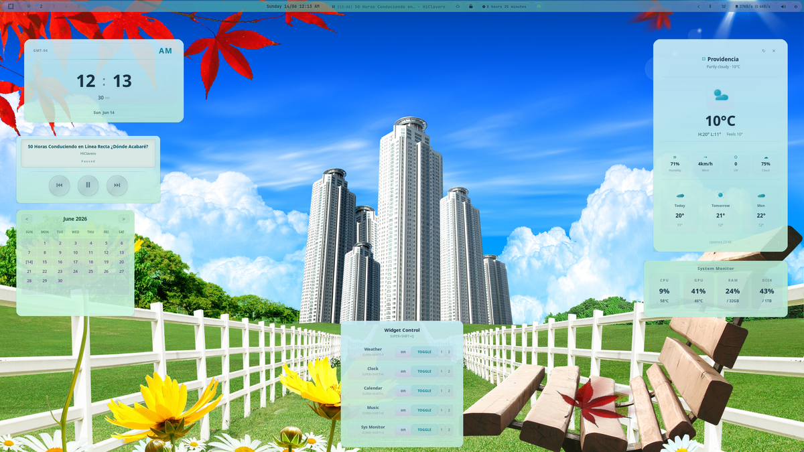

# Omarchy Frutiger Aero

A light Frutiger Aero theme for [Omarchy](https://github.com/omacom/omarchy): a teal and sky-blue
palette, glossy Waybar pills, a matching lockscreen and three Frutiger Aero wallpapers.



## Install

```bash
omarchy theme install https://github.com/VECTORG99/omarchy-frutiger-aero
```

This repository holds only theme files, so that command is all there is to it.
Switch back and forth with `omarchy theme set`.

## What's in it

| File | What it styles |
|------|----------------|
| `colors.toml` | Palette (accent, background, foreground, color0–15) |
| `waybar.css`, `waybar.style` | Bar colors and the pill style |
| `walker.css` | App launcher |
| `mako.ini` | Notifications |
| `swayosd.css` | Volume and brightness OSD |
| `hyprlock.conf`, `unlock.png` | Lockscreen |
| `icons.theme` | Icon theme name |
| `light.mode` | Marks this as a light theme |
| `backgrounds/` | Three wallpapers |
| `preview.png`, `preview-unlock.png` | Previews for the theme switcher |

### Palette

| Token | Hex |
|-------|-----|
| Background | `#5AACA0` |
| Foreground | `#1A3344` |
| Accent | `#1299CA` |

## Extras

The dark variant, the Vista-style Hyprland and Waybar configs and the EWW desktop
widgets are code, so they live in their own repository with their own installer:
[omarchy-frutiger-aero-extras](https://github.com/VECTORG99/omarchy-frutiger-aero-extras).
Read it before you run it; it replaces files in `~/.config`.

## Credits

- [Omarchy](https://github.com/omacom/omarchy)
- [Omarchy on CachyOS](https://github.com/roboff/omarchy-on-cachyos) by [Mr. Roboff](https://github.com/roboff), the base this was built on
- [Asadal](https://www.asadal.com) and Perfect Hue, the original Frutiger Aero wallpapers

## License

The theme files are [MIT](LICENSE), Copyright (c) 2026 Diego Hernandez.

The MIT license does not cover the wallpapers in `backgrounds/`. They come from
Frutiger Aero collections by Asadal and Perfect Hue and remain their authors'
property. If you hold the rights to one of them and want it removed, open an
issue and it will be taken down.
